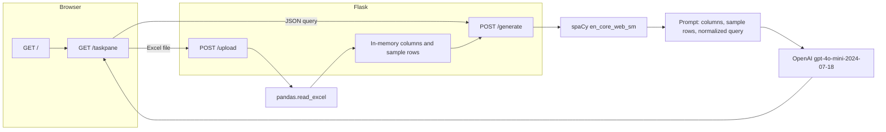

# FormulAI

Plain-language questions in, Excel formulas out, using the columns and sample rows of a workbook you upload.

FormulAI is a Flask app that turns a business question into an Excel formula. Upload a spreadsheet, describe the calculation in English, and the app asks a language model for a formula that uses that file's headers.

## Problem

Excel formulas are exact, and the question that leads to one usually is not. A request such as "total layoff count for Travis county" still has to be mapped onto the right headers, ranges, and functions (`SUMIF`, `XLOOKUP`, and the rest).

## Solution

FormulAI keeps the sheet next to the question:

1. An `.xls` or `.xlsx` file is read with pandas. Only the first worksheet is used.
2. Column names and the first five rows stay in memory for the life of the process.
3. The question is normalized with spaCy (`en_core_web_sm`): punctuation and stopwords are dropped, and the remaining tokens are lemmatized.
4. That text, plus the columns and sample rows, is sent to the OpenAI Chat Completions API (`gpt-4o-mini-2024-07-18`).
5. The model's reply is returned unchanged. FormulAI does not parse it, run it, or check it in Excel.

## Features

- Landing page at `/` and a task pane at `/taskpane` for upload and generation.
- `POST /upload` accepts one Excel file (up to 16 MB), saves it under `uploads/`, and keeps the column names and five sample rows.
- `POST /generate` accepts JSON `{"query": "..."}` and returns `{"formula": "..."}`.
- The task pane calls those routes on the same origin, so the UI and API run together locally or behind one host.
- A `Procfile` for a Render-style service: `web` starts the app, and `release` downloads the spaCy model.

## Architecture



## Tech stack


| Piece | Role in this repo |
| --- | --- |
| Python 3.9, 3.10, or 3.11 | Runtime. numpy 1.24.3 and spaCy 3.6.0 do not support 3.12. |
| Flask 3.0.3 | Pages and JSON API |
| pandas 2.2.2, openpyxl 3.1.2, xlrd 2.0.1 | Read `.xlsx` and `.xls` |
| spaCy 3.6.0 (`en_core_web_sm`) | Lemma and stopword pass over the question |
| click 8.1.8 | Kept below 8.2 so `python -m spacy download` still resolves the model |
| openai 1.43.0 | Chat Completions call |
| python-dotenv 1.0.0 | Load `OPENAI_API_KEY` from `.env` |

## Setup

### Prerequisites

- Python 3.9, 3.10, or 3.11
- An OpenAI API key for formula generation. The pages and the upload route load without one.

### Run locally

```bash
python3.11 -m venv .venv
source .venv/bin/activate
pip install -r requirements.txt
python -m spacy download en_core_web_sm
cp .env.example .env
```

Put your key in `.env`:

```bash
OPENAI_API_KEY=sk-...
```

Start the app:

```bash
# optional: Flask reloader
export FLASK_DEBUG=1
python app.py
```

Open [http://127.0.0.1:5000](http://127.0.0.1:5000). The process listens on `0.0.0.0` and on `PORT` (default `5000`).

On import, `utils/formula_generation.py` downloads `en_core_web_sm` with the current interpreter if the model is missing. Installing it first keeps the first boot from doing that download.

### Render

`Procfile` is written for Render:

```
web: python app.py
release: python -m spacy download en_core_web_sm
```

Set `OPENAI_API_KEY` in the service environment. Leave `FLASK_DEBUG` unset so the reloader stays off.

## Usage

1. Open the landing page and choose **Generate Now**.
2. Upload an `.xls` or `.xlsx` file. A check mark means the upload succeeded. A later upload replaces the one in memory.
3. Type a question and choose **Generate Formula**.

The sheet needs a header row and at least one data row. An empty sample is treated as a missing file.

Example, for a workbook whose columns include `COUNTY_NAME` and `TOTAL_LAYOFF_NUMBER`:

```bash
curl -s -F "file=@listings.xlsx" http://127.0.0.1:5000/upload
```

```json
{"message": "File listings.xlsx uploaded successfully!"}
```

```bash
curl -s -H "Content-Type: application/json" \
  -d '{"query":"sum the layoff number for Travis county"}' \
  http://127.0.0.1:5000/generate
```

```json
{"formula": "<model text>"}
```

`formula` is the model's full reply. The prompt asks for an Excel formula and does not require the reply to be a single cell formula, so the text often includes a short explanation as well.

Before that call, spaCy reduces the question. With `en_core_web_sm`, "sum the layoff number for Travis county" becomes `sum layoff number Travis county`, because words such as "the" and "for" are stopwords. The same pass drops words that change the calculation, including "by", "where", "not", and "without". Lemmatization also folds forms such as "closed" to "close".

| Request | Response |
| --- | --- |
| Missing or blank `query` | HTTP 400, `{"message": "Query is missing"}` |
| Generate before a successful upload | HTTP 400, `{"message": "No file uploaded or file data missing"}` |
| File other than `.xls` or `.xlsx` | HTTP 400, `{"message": "Invalid file type. Please upload an Excel file."}` |
| Body over 16 MB | HTTP 413 |
| Missing `OPENAI_API_KEY` | HTTP 200, `formula` explains that the key is not set |
| OpenAI or network failure | HTTP 200, `formula` is `Error generating formula.` |

## Project structure

```
app.py                       Flask routes
Procfile                     Render web and release commands
requirements.txt             Pinned Python dependencies
utils/formula_generation.py  spaCy preprocess and OpenAI call
templates/index.html         Landing page
templates/taskpane.html      Upload and generate UI
static/cc/taskpane.js        Duplicate client, not loaded by the templates
assets/                      Logo and 16, 48, and 128 px icons
uploads/                     Runtime folder for saved workbooks (gitignored)
```

The repo has no Office Add-in manifest. The icon sizes and the task pane name are the only traces of that layout. `templates/taskpane.html` contains the script the page actually runs. `static/cc/taskpane.js` repeats the same two calls and is not referenced by the templates.

## How a request is built

The user message sent to the model looks like this:

```
Columns: ['COUNTY_NAME', 'TOTAL_LAYOFF_NUMBER']
Sample Data:
[{'COUNTY_NAME': 'Travis', 'TOTAL_LAYOFF_NUMBER': 96}, ...]
Generate an Excel formula for: sum layoff number Travis county
```

The sample is at most five records. Empty cells are sent as `None`. The model id is hard-coded as `gpt-4o-mini-2024-07-18`.

## Current behavior worth knowing

- One process-wide dictionary holds the latest upload. A second upload, or a second person using the same process, replaces it. There is no session and no database.
- The workbook is written under `uploads/` and left there. Generation uses the parsed columns and sample rows, not a second read of the file.
- Uploaded files are addressed by filename only, so two workbooks with the same name overwrite each other on disk.
- The model output is stored and displayed as text.
- The app has no authentication, rate limit, or automated tests.

## Roadmap

- Store each upload on a session, or in a short-lived store, instead of one process-wide dictionary.
- Ask the model for a formula only, then check that it parses and that the headers it names exist on the sheet.
- Send the original question along with the normalized form so function words such as "by" and "not" survive.
- Add a small set of workbooks and expected formula shapes as tests.
- Add an Office Add-in manifest if the task pane should run inside Excel. The icon files are already sized for that.

## License

MIT. See [LICENSE](LICENSE).
